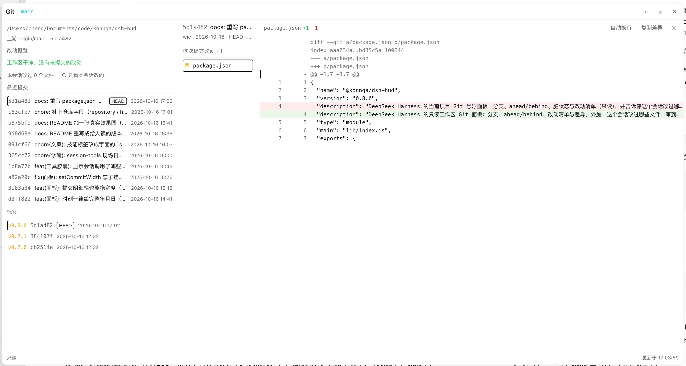
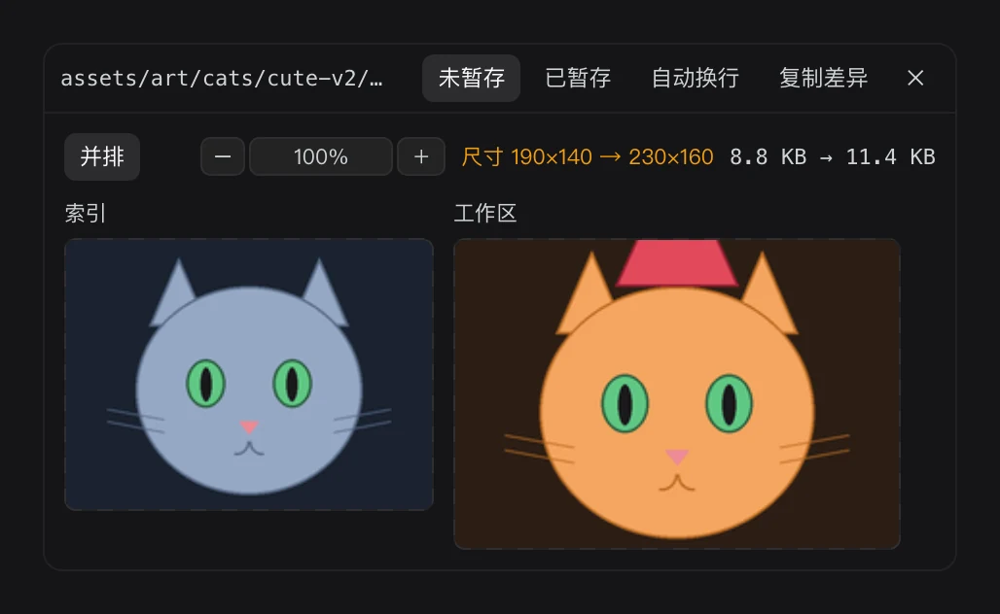

# dsh-hud

[](https://www.npmjs.com/package/@konnga/dsh-hud) [](#install) [](LICENSE)

**English** | [中文](./README.md)

A read-only DeepSeek Harness status panel: branch, ahead/behind, changed files and diffs — plus which files *this session* touched, what you have reviewed, and what tools ran.

> Screenshots in this file were taken in the **Chinese UI**; the plugin's own labels follow your UI language, and every quoted label below is the English one you would actually see.


## Install

Desktop: **Settings → Plugins → Add plugin**, then enter `@konnga/dsh-hud`.

For local development, point the profile at the checkout (host changes apply immediately; client code is re-read on app restart):

```json
"@konnga/dsh-hud": "link:/path/to/dsh-hud"
```

## What it gives you

| Feature | In one line | Where |
| --- | --- | --- |
| **Git capsule** | Workspace name, branch, ahead/behind, change counts, files this session touched | Leftmost of the row above the composer (click to open the panel) |
| **Tools capsule** | What is running now (live seconds), per-tool call counts, skills used | Same row, middle |
| **Session timer capsule** | How long this session has been running; hover for model/tool wall time and turns | Same row, rightmost |
| **Panel** | Change overview, change list, recent commits, tags; click any row for its diff | Click the Git capsule |
| **Diffs, commit detail, images** | Unstaged / staged, word wrap, copy diff; image side-by-side + zoom | Right of the panel, draggable |
| **Per-turn image changes** | Images touched this turn: click to view one, `⇄` for before/after | Next to the built-in "edited N files" card |
| **Sidebar session rows** | Hover or click `⋯` to expand: git summary + per-session attribution | Every sidebar session row |
| **Keyboard** | `↑↓` `Enter` `[ ]` `n p` `Space` `v` `r` `Esc` inside the panel | Once the panel is active |
| **`↑` prompt recall** | Empty composer + `↑` brings back your previous prompt | In the composer |

## What you will see

### Capsules (the row above the composer)

```
dsh-hud · git:(main*) ↑1 ↓2 M4 A1 ?1 │ ●3   │   ✓ bash ×16 │ …   │   ⏱ 2h 14m
```

> Hover tips on all three capsules are **bubbles the plugin draws itself** — not the browser's native tooltip, which never showed up in the real app and whose delay and styling we cannot control anyway.

**Git** (leftmost)

- `dsh-hud` — workspace name (elided in the middle when long; hover for the full path). Shown even outside a git repository.
- `git:(main*)` — branch. `*` means the worktree is dirty; detached shows `git:(detached abc1234)`.
- `↑1 ↓2` — ahead/behind the upstream (hidden when zero).
- `M4 A1 ?1` — change counts, only non-zero ones: `M` modified · `A` added · `D` deleted · `R` renamed · `C` copied · `T` type change · `?` untracked · `!` conflicted.
- `●3` — this session changed 3 files (hidden when there are none).

**Tools** (middle, appears once a tool has run)

```
◐ bash: pnpm test 1.2s                                     ← running, seconds tick live
✓ bash ×16 │ ✓ apply_patch ×6 │ skills: office-xlsx ×2 +2   ← idle
```

- One count per tool; the leading `✓` / `✗` is the result of **its own most recent** call.
- After `skills:` come skill *names* (so you can tell which skill, not just how many calls).
- At most 3 tools + 2 skills are laid out; the rest collapse into `+k`. Hover for the full list and the latest results.

**Session timer** (rightmost)

```
⏱ 2h 14m
```

- **How long this session has been running.** Same definition as [codex-hud](https://github.com/konnga/codex-hud)'s session duration: `now − session createdAt` (idle time included). Format: `<1m` / `45m` / `2h 14m` / `3d 2h`.
- Hover adds what actually happened during that time:

  ```
  This session's running time · started 2026-10-14 17:58 · model 1h 29m, tools 23m · 27 turns / 380 steps
  ```

  The last two come from the built-in `sessionStats` projection; when that projection is absent we show the wall clock only and invent nothing.
- Right after a restart it may be missing for a few seconds: the session is restored into the host store asynchronously (measured: about 30 s). So a failed lookup is retried every **3 s** and drops to once a minute once it succeeds. If the session is archived or the host has no `sessions` service, the capsule is not drawn at all.

Here it is on a real machine:


*The same bubble is used by the Git and tools capsules (the Git one is multi-line: full path / upstream / per-type counts).*

### Panel (click the Git capsule)



*Above: viewing a commit. The title bar is draggable; `⟳` refresh · `⌖` reset position · `✕` collapse.*

1. **Repository path · upstream · short oid**
2. **Summary** — coloured counts grouped by kind; says `Working tree clean — nothing uncommitted` when it is.
3. **This session's changes** — one line of counts plus the toggles `Only this session's` and `Latest turn only`; with review marks you also get `3/8 reviewed` and `Clear reviewed`.
4. **Changes** — each row is `marker status-letter path`, renames read as `old → new`.
   - Leading `●` definitely changed · `◐` possibly changed (inferred from a command; hover shows that command) · `○` unrelated to this session.
   - Trailing `○` / `✓` is the review mark — click it or press `v`; `✓` turning yellow means the file changed again and needs another look.
   - Click any row for that file's diff.
5. **Recent commits** — `shortsha subject [HEAD] 2026-10-16 14:18`; click a row to view that commit, click again to collapse.
6. **Tags** — newest first; click a row to view the commit it points at. A repository without tags says so.

Every timestamp is a **full date + time** in your local zone.

### Diffs, commit detail and images

- **Diff view**: two columns, toolbar with `Unstaged` / `Staged` / `Wrap lines` / `Copy diff`; click a hunk header to fold that hunk.
- **Commit view**: three columns — panel │ commit │ diff — and it opens the commit's first file for you.
- **Two grips to drag**: the one on the right edge sets the diff width (default 470px), the one right of the commit column sets that column's width (default 240px). Both widths are remembered.
- **Image changes**: files recognised as images (PNG / JPEG / GIF / WebP / BMP, **by file header, not by extension**) are drawn side by side with size and byte deltas (`size 1024×768 → 1024×512`, `2.0 KB → 1.0 KB`). When an image cannot be drawn the reason is stated: over the 4 MB per-side limit, not a previewable image, or that side missing (added / deleted).
- **Image zoom**: an always-visible `−` / step / `＋`, defaulting to fit-width, with steps 25% / 50% / 100% / 150% / 200% computed from the image's intrinsic pixels; clicking the step itself returns to fit-width. The step is remembered.



### Per-turn image changes


The built-in "edited N files" card cannot show images, so the plugin puts its own door on that same turn tail:

- click a thumbnail → open that image in the built-in document preview on the right;
- click `⇄` → open this plugin's panel for a **before/after** comparison (the built-in preview only has the current version);
- only images touched **in this turn** are listed, newest first, up to 4 plus `N more`; when a turn touched no images the whole strip is not rendered;
- both attribution tiers are included: files written by tools count as certain, ones inferred from shell commands are marked `◐` (hover shows the command) — images are usually produced by scripts, so certain-only would often be empty.

### Sidebar session rows

The sidebar row itself carries no marks; the information is in the hover card or behind the row-end `⋯`:

```
main* ↑0 ↓0 · modified 7 untracked 2
3 file(s) changed by this session · 4 path(s) commands may have touched (1 still differ)
```

When clean it says `Working tree clean — nothing uncommitted` and `this session has no recorded changes`.

### Keyboard

**Click inside the panel first** (or Tab into it) before it takes over keys; clicking outside hands them back. Cmd/Ctrl/Alt combinations and keys typed in the composer are never touched.

| Key | Action |
| --- | --- |
| `↑` `↓` | Move the selected row (move only, does not open) |
| `Enter` | Open the selected row |
| `[` `]` | Previous / next file, opening it right away |
| `n` `p` | Next / previous hunk (folded ones expand) |
| `Space` | Fold / unfold the current hunk |
| `v` | Mark the current row as reviewed for this revision (press again to clear) |
| `r` | Re-read |
| `Esc` | Step back: collapse the right column (diff / commit) first, then the panel |

While viewing commit detail, `↑ ↓ Enter [ ]` act on that column's list.

### `↑` in the composer recalls your previous prompt

With the composer empty, `↑` brings back your previous prompt; keep pressing to walk further back, `↓` walks forward, and stepping past the newest returns you to your original draft.

- **Plain text only**: `/commands` and `@files` are text already, so they come back intact; attachments and images do not come back (they were never part of the prompt text).
- **Sourced from the session log** (the built-in `turnOutline` projection), not from a copy the plugin keeps — so restarts, paging and compaction do not affect it, and **prompts sent from another client can be recalled too**. If the host lacks that projection, the whole feature silently stays off.
- **It never takes over while the composer has content**, so `↑` in a multi-line draft is always just cursor movement, and it cannot fight the `/` command or `@` mention popups. Modifier keys, IME composition and a non-collapsed selection all make it step aside.
- Typing exits history mode, so a draft is never restored over new content.

> Implementation note: DSH's composer is a Lexical `contenteditable`, and a plugin cannot reach its internal model — so we simulate a paste (falling back to `execCommand`, then to writing text directly), and each tier re-reads the composer after the write has landed before deciding it succeeded. This is the only part of the plugin that touches the DOM; if DSH changes that structure it may stop working, in which case it silently disables itself.

## Development

- `lib/index.js` — the host half (runs git, serves `/dsh-hud-rpc`).
- `lib/client.js` — the browser half (**no build step**, hand-written JS, depends only on the seed module `react`).
- `npm test` — the whole suite (`node --test test/*.test.mjs`). No dependencies to install.
- `docs/dock-slot-host.md` — a proposal for turning the row above the composer into a registrable inline host.
- **Releasing**: `npm run tag && npm publish`. `prepublishOnly` runs the tests and then verifies version ↔ git tag (clean tree, `v<version>` exists and points at HEAD); a mismatch blocks the publish.

## License

MIT
