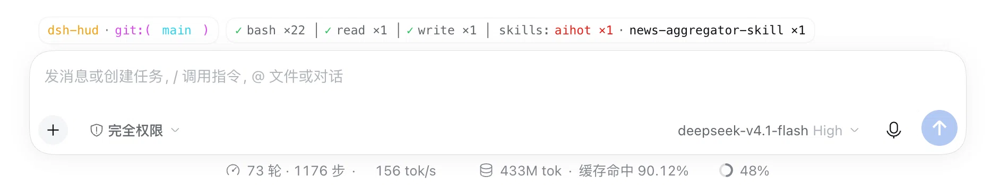
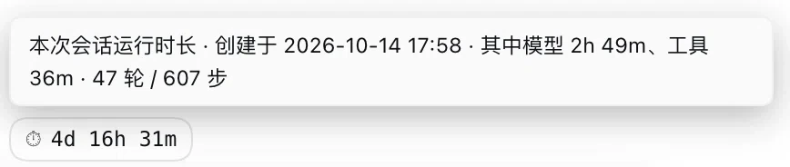
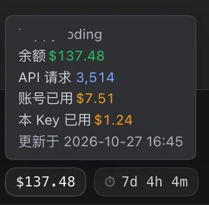
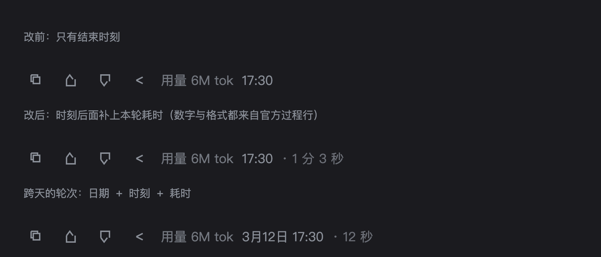
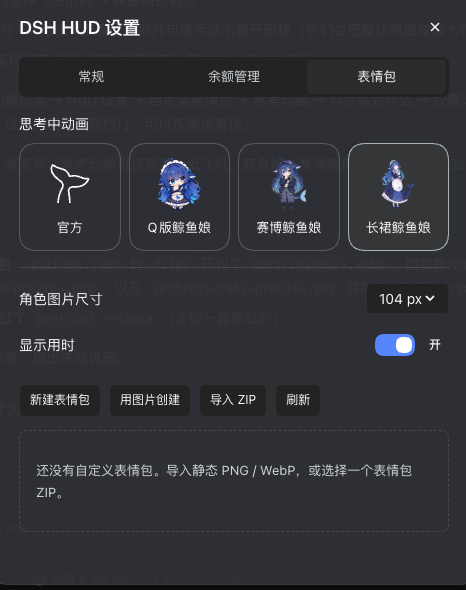
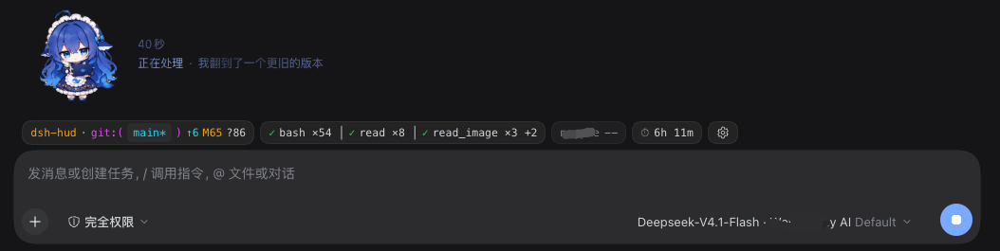
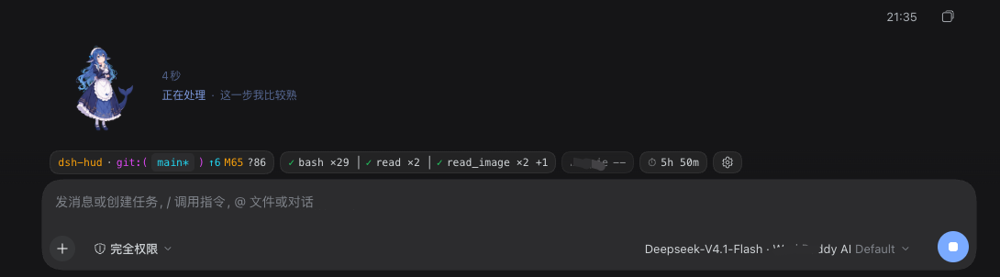
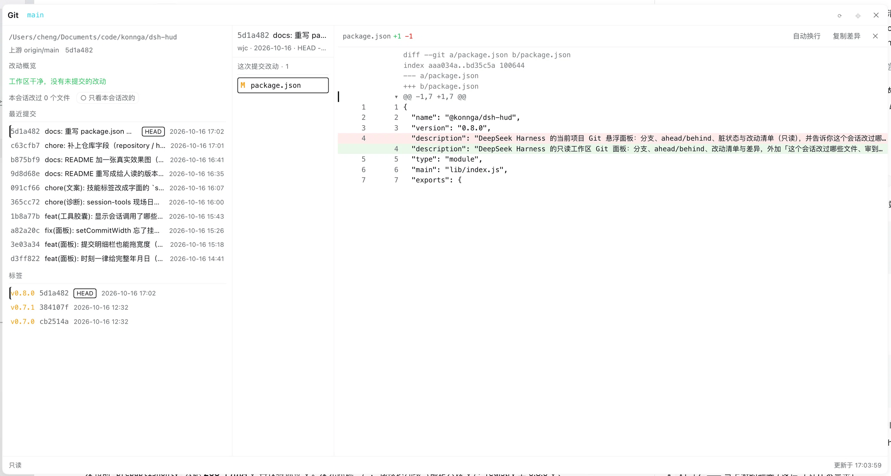
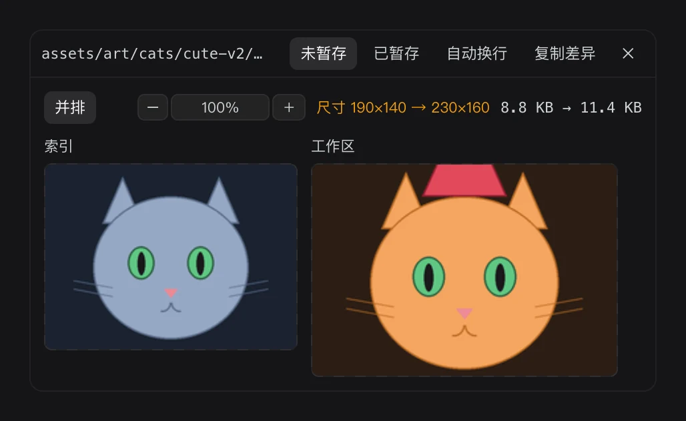

# dsh-hud

[](https://www.npmjs.com/package/@konnga/dsh-hud) [](#install) [](LICENSE)

**English** | [中文](./README.md)

One extra row under your composer: branch and change state, what is running, how long this session has been going, how much credit is left — plus a whale girl who changes pose with the tool in play.

> Screenshots are from the Chinese UI; the plugin's own labels follow your UI language.



## Install

Desktop: **Settings → Plugins → Add plugin**, then `@konnga/dsh-hud`.

For local development, point the profile at the checkout (client code is re-read on app restart):

```json
"@konnga/dsh-hud": "link:/path/to/dsh-hud"
```

## Feature overview

```
dsh-hud · git:(main*) ↑1 ↓2 M4 A1 ?1 │ ●3   │   ✓ bash ×16 │ …   │   ⏱ 2h 14m   │  ¥128.40+
```

| Feature           | What you see                                                                                | Where                             |
| ----------------- | ------------------------------------------------------------------------------------------- | --------------------------------- |
| **Git**           | Workspace, branch, `↑`/`↓`, change counts, files this session touched                       | Leftmost; click to open the panel |
| **Tools**         | What is running (live seconds), per-tool counts, skills used                                | Middle                            |
| **Session timer** | How long this session has run; hover for model/tool time and turns                          | Second from right                 |
| **Balance**       | Follows the session's model provider — account, own key, or relay, each with its own ledger | Rightmost                         |
| **Panel**         | Overview, file list, recent commits, tags; click a row for its diff                         | Click the Git capsule             |
| **Turn duration** | How long each turn took, next to its clock                                                  | Actions row under each reply      |

## Details

### Capsules

- **Git**: `M4 A1 ?1` lists only non-zero counts (`M` modified, `A` added, `D` deleted, `R` renamed, `C` copied, `T` type, `?` untracked, `!` conflict); `●3` = 3 files touched this session; `*` = dirty worktree.
- **Tools**: `✓`/`✗` is that tool's **own last** result; `skills:` lists skill names, not counts; shows 3 tools + 2 skills, the rest collapse to `+k`.
- **Session timer**: `now − first turn/start`, including idle gaps. It starts at the first message rather than file creation — an empty session can sit for days, which would render as "16d".
- **Balance**: an official account reads the account wallet, a relay reads its own balance; when unreadable it shows `--` rather than borrowing another number. Left-click refreshes, right-click opens the provider's usage page.
- Hover bubbles are drawn by the plugin (native tooltips never appear in the real app).




### Turn duration

The actions row used to show only the end clock. Now:

```
用量 13.9M tok    21:05 · 5m 46s
```

Toggle it at **Settings → General → Chat → Turn duration**.



### Thinking animation

Four choices: Official, Chibi Whale Girl, Cyber Whale Girl, Longdress Whale Girl.



The whale girl has 30 poses tied to the current tool and a pool of 100 cues, rotating every 6 seconds. While running: pose on the left, elapsed time above, phrase below:




Cyber Whale Girl is a second 30-pose techwear set. Longdress has 9 poses; anything unmapped falls back to the thinking image.

[All phrases](docs/running-text.md) · [Asset maintenance](docs/whale-assets.md)

### Expression packs

The **Expression packs** tab lets you build a pack from your own images, import/export ZIPs, map actions, replace single images and delete packs. Only one default thinking image is required; unmapped actions reuse it instead of borrowing another character. Images and selection live in a dedicated Host storage domain — not the plugin directory, not localStorage.

[Usage and ZIP format](docs/expression-packs.md) · [Importable example](docs/expression-packs/cyber-whale-girl.zip)

### Settings

The gear capsule opens DSH HUD settings:

- **General**: capsule visibility (Git / tools / balance / session timer) + chat (turn duration). The gear stays even if every capsule is hidden.
- **Expression packs**: skins, image size (32–104px), elapsed time, custom packs.
- **Balance management**: relays and balance queries; keys are masked, revealable, copyable, never persisted.

Close with `Esc` or a click outside. New Host endpoints need a DSH restart to load.

### Panel

Click the Git capsule: overview, per-file list, recent commits, tags. Click a row for its diff — the right pane is draggable. Unstaged and staged are separate; word wrap, copy diff, and side-by-side image comparison with zoom are supported.




Shortcuts inside the panel: `↑↓` to move, `Enter` to open, `[ ]` for tabs, `n p` for next/previous hunk, `Space` to page, `v` to switch view, `r` to refresh, `Esc` to close.

### Sidebar and more

- Every sidebar session row expands on hover or `⋯`: git summary + per-session attribution.
- "Per-turn image changes" at the end of a reply: images touched this turn, click to view one, `⇄` for before/after.


## Development

```bash
pnpm install
pnpm typecheck   # types
pnpm test        # full suite
pnpm build       # lib/ (host + client bundle)
```
