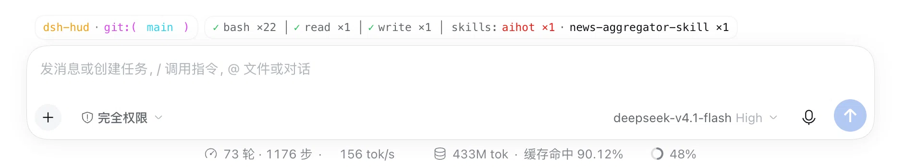
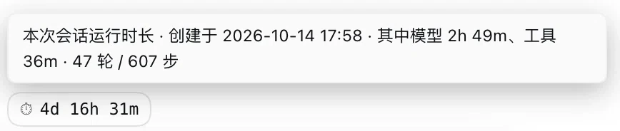
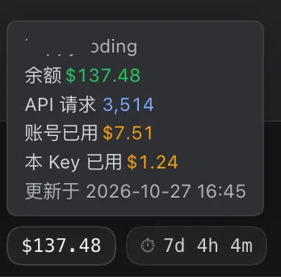
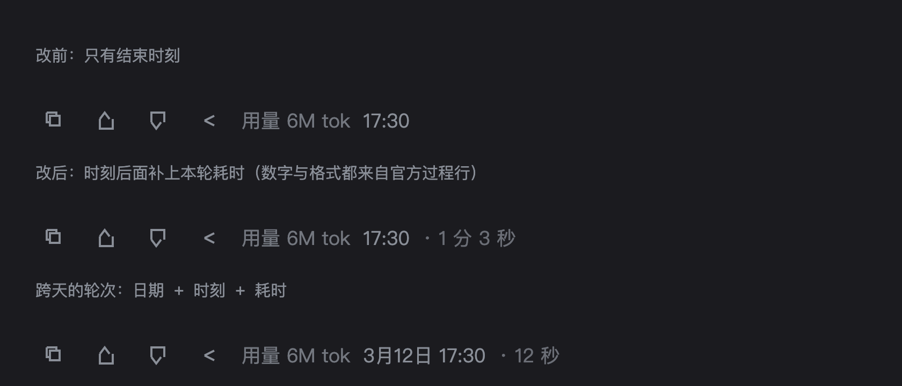
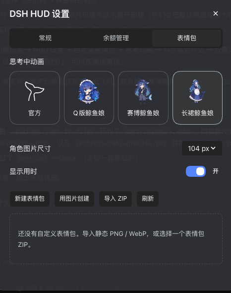
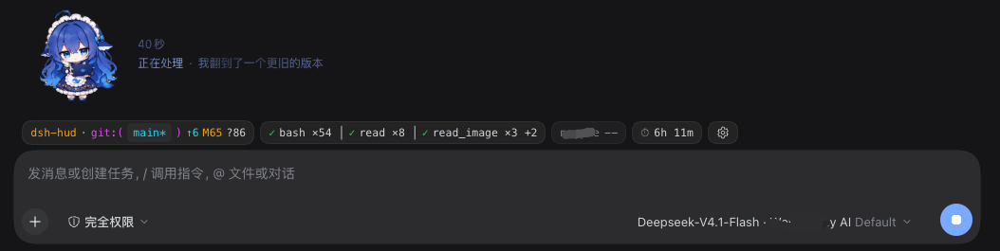
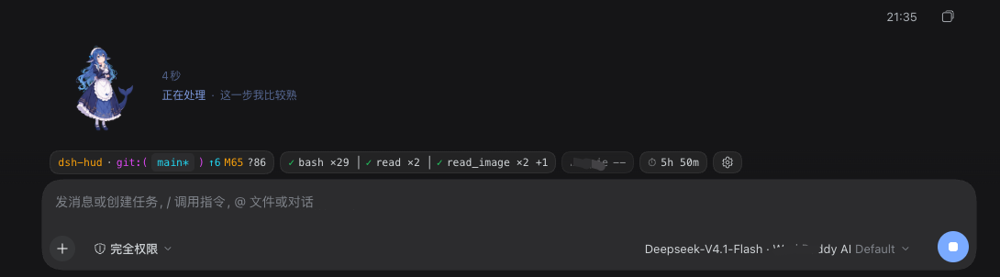
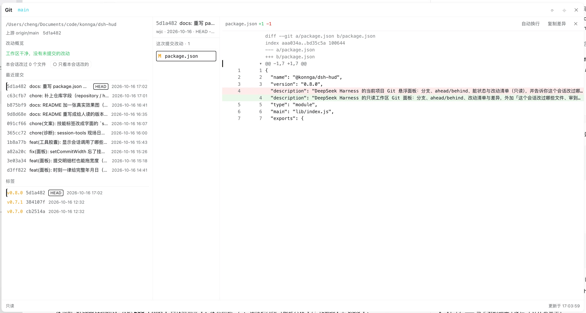
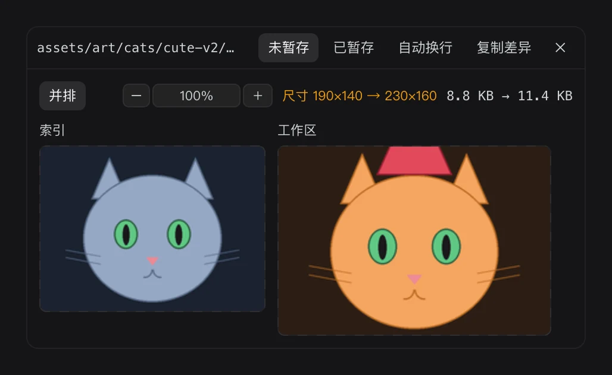

# dsh-hud

[](https://www.npmjs.com/package/@konnga/dsh-hud) [](#安装) [](LICENSE)

[English](./README.en.md) | **中文**

DSH 底部多一行：分支和改动状态、正在跑什么、本次会话多久、还剩多少钱，再配一只会跟着工具换姿势的鲸鱼娘。



## 安装

桌面端「设置 → 插件 → 添加插件」，填 `@konnga/dsh-hud`。

本地开发时把 profile 依赖指向仓库（客户端代码要重启应用才重读）：

```json
"@konnga/dsh-hud": "link:/path/to/dsh-hud"
```

## 功能总览

```
dsh-hud · git:(main*) ↑1 ↓2 M4 A1 ?1 │ ●3   │   ✓ bash ×16 │ …   │   ⏱ 2h 14m   │  ¥128.40+
```

| 功能         | 看到什么                                                           | 在哪儿           |
| ------------ | ------------------------------------------------------------------ | ---------------- |
| **Git**      | 工作区名、分支、`↑`/`↓`、改动计数、本会话改过几个文件              | 行首，点它开面板 |
| **工具**     | 正在跑的命令（秒数实时跳）、各工具调用次数、用过的技能             | 中间             |
| **会话计时** | 本次会话跑了多久；悬停给模型/工具耗时与轮次                        | 右二             |
| **余额**     | 跟着当前会话的模型来源走：官方账号、自己的 Key、中转站各有各的账本 | 最右             |
| **面板**     | 改动概览、清单、最近提交、标签，点一行看差异                       | 点 Git 胶囊      |
| **轮尾耗时** | 每条回复后面补上这一轮花了多久                                     | 回复下方动作栏   |

## 细节

### 胶囊

- **Git**：`M4 A1 ?1` 只列非零项（`M` 改 `A` 增 `D` 删 `R` 重命名 `C` 复制 `T` 类型 `?` 未跟踪 `!` 冲突）；`●3` 是本会话改过 3 个文件；`*` 表示工作区不干净。
- **工具**：`✓`/`✗` 是它**自己最近一次**调用的结果；`skills:` 后面是技能名而不是次数；最多铺 3 个工具 + 2 个技能，其余收成 `+k`。
- **会话计时**：`现在 − 第一条 turn/start`，含中间的等待与空闲。用第一条消息而不是创建时刻——空会话可能闲置好几天，按创建算会出现「16 天」。
- **余额**：用官方账号查账号钱包，用中转站查那家的余额；读不到就画 `--`，绝不拿别人的数顶上。左键立即刷新，右键开平台用量页。
- 悬停气泡是插件自己画的（原生 tooltip 在真机上不出现）。




### 每轮耗时

回复动作栏本来只有结束时刻，现在后面多一段：

```
用量 13.9M tok    21:05 · 5 分 46 秒
```

开关在「设置 → 通用 → 对话 → 显示每轮耗时」。



### 思考动画

四选一：官方、Q版鲸鱼娘、赛博鲸鱼娘、长裙鲸鱼娘。



鲸鱼娘有 30 种动作，跟着当前工具和 100 条轮播，每 6 秒更换。运行时左侧是动作、上方是用时、下方是文案：




赛博鲸鱼娘是另一套 30 张工装风。长裙鲸鱼娘 9 张，没画到的动作回退到思考图。

[全部文案](docs/running-text.md) · [资源维护](docs/whale-assets.md)

### 表情包

「表情包」页可以用自己的图建包、ZIP 导入导出、给动作映射、单张替换、删除。只要求一张默认思考图，没配的动作复用这张，不会混进别的角色。素材存在宿主独立数据域，不写进插件目录，也不进 localStorage。

[使用方法与 ZIP 规范](docs/expression-packs.md) · [可导入的示例包](docs/expression-packs/cyber-whale-girl.zip)

### 设置

齿轮胶囊打开「DSH HUD 设置」：

- **常规**：胶囊显示（Git / 工具 / 余额 / 会话计时）+ 对话（每轮耗时）。全隐藏了齿轮还在。
- **表情包**：皮肤、角色图片尺寸、显示用时、自定义包。
- **余额管理**：中转站列表与余额查询，密钥默认遮罩，可查看/复制，不落盘。

`Esc` 或点浮层外侧关闭。新增的宿主接口需要重启 DSH 才加载。

### 面板

点 Git 胶囊打开：改动概览、逐文件清单、最近提交、标签；点任意一行看差异，右侧可拖动调整大小。未暂存/已暂存分开，支持自动换行、复制差异、图片并排对比与缩放。




面板内快捷键：`↑↓` 选行，`Enter` 打开，`[ ]` 切标签，`n p` 上下条差异，`Space` 翻页，`v` 切换视图，`r` 刷新，`Esc` 关闭。

### 侧栏与其它

- 侧栏每个会话行悬停或点 `⋯`：git 摘要 + 本会话归因。
- 回复末尾「本轮图片改动」：这一轮动过的图，点开看单张，`⇄` 看前后对比。


## 开发

```bash
pnpm install
pnpm typecheck   # 类型检查
pnpm test        # 全量用例
pnpm build       # 产出 lib/（宿主端 + 客户端 bundle）
```
