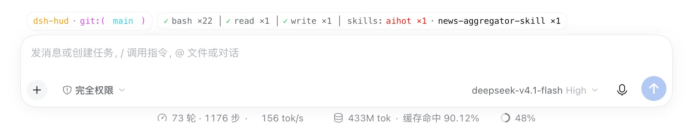
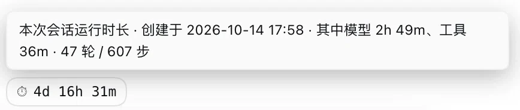
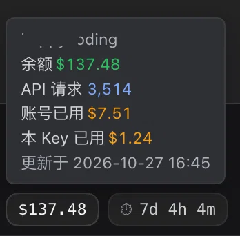

# dsh-hud

[](https://www.npmjs.com/package/@konnga/dsh-hud) [](#安装) [](LICENSE)

[English](./README.en.md) | **中文**

DeepSeek HUD 状态面板：分支、ahead/behind、改动清单与差异，外加「这个会话改过哪些文件、审到哪了、跑了什么工具」。



## 安装

桌面端「设置 → 插件 → 添加插件」里填 `@konnga/dsh-hud`。

本地开发时把 profile 的依赖指向仓库（改动即时可见；客户端代码要重启应用才重读）：

```json
"@konnga/dsh-hud": "link:/path/to/dsh-hud"
```

## 功能总览

| 功能                           | 一句话                                                                                                                                                                                                 | 在哪儿                               |
| ------------------------------ | ------------------------------------------------------------------------------------------------------------------------------------------------------------------------------------------------------ | ------------------------------------ |
| **Git 胶囊**             | 工作区名、分支、ahead/behind、改动计数、本会话改过几个文件                                                                                                                                             | 输入框上方那一行，最左（点它开面板） |
| **工具胶囊**             | 正在跑什么（实时秒数）、各工具调用次数、用过的技能                                                                                                                                                     | 同一行，中间                         |
| **会话计时胶囊**         | 本次会话已运行多久；悬停给模型 / 工具墙钟与轮次                                                                                                                                                        | 同一行，最右（余额之后）             |
| **余额胶囊**             | **跟着当前会话的模型来源走**：用官方账号就查账号余额，用中转站就查那家的余额；低余额 `⚠` 提醒，**点一下可填网页令牌**（拿得到"当前余额"），悬停给余额 / API 请求 / 账号已用 / 本 Key 已用 | 同一行，计时之前                     |
| **面板**                 | 改动概览、改动清单、最近提交、标签；点任意一行看差异                                                                                                                                                   | 点 Git 胶囊                          |
| **差异与提交明细**       | 未暂存 / 已暂存、自动换行、复制差异；图片并排对比 + 缩放                                                                                                                                               | 面板右侧，可拖动                     |
| **轮尾「本轮图片改动」** | 这一轮动过的图：点开看单张，`⇄` 看前后对比                                                                                                                                                          | 内置「已编辑 N 个文件」卡片旁        |
| **侧栏会话行**           | 悬停或点 `⋯` 展开：git 摘要 + 本会话归因                                                                                                                                                            | 侧栏每个会话行                       |
| **键盘**                 | 面板内 `↑↓` `Enter` `[ ]` `n p` `Space` `v` `r` `Esc`                                                                                                                                | 面板激活后                           |
| **输入框 `↑` 召回**   | 空输入框按 `↑` 带回上一条 prompt                                                                                                                                                                    | 输入框里                             |

## 你会看到什么

### 胶囊（输入框上方那一行）

```
dsh-hud · git:(main*) ↑1 ↓2 M4 A1 ?1 │ ●3   │   ✓ bash ×16 │ …   │   ⏱ 2h 14m   │  ¥128.40+
```

> 几枚胶囊的**悬停提示是插件自己画的气泡**（不用浏览器原生 tooltip —— 它在真机上不出现，延迟与样式也控制不了）。

**Git**（最左）

- `dsh-hud` —— 工作区名（太长从中间省略，完整路径看悬停）。不在 git 仓库里也会显示。
- `git:(main*)` —— 分支。`*` 表示工作区不干净；detached 时是 `git:(detached abc1234)`。
- `↑1 ↓2` —— 与上游的领先 / 落后（为 0 不显示）。
- `M4 A1 ?1` —— 改动计数，只列非零项：`M` 改 · `A` 增 · `D` 删 · `R` 重命名 · `C` 复制 · `T` 类型 · `?` 未跟踪 · `!` 冲突。
- `●3` —— 本会话改过 3 个文件（没有就不显示）。

**工具**（中间，运行过的工具才出现）

```
◐ bash: pnpm test 1.2s                                     ← 正在跑，秒数实时跳
✓ bash ×16 │ ✓ apply_patch ×6 │ skills: office-xlsx ×2 +2   ← 空闲
```

- 每个工具一个计数，前面的 `✓` / `✗` 是**它自己最近一次**调用的结果。
- `skills:` 后面是技能名（看得出是哪一个，不是"技能调了几次"）。
- 最多铺 3 个工具 + 2 个技能，其余收成 `+k`；悬停里有完整清单与最近几条结果。

**会话计时**（最右，余额胶囊之后）

```
⏱ 2h 14m
```

- **本次会话已运行多久**。口径与 [codex-hud](https://github.com/konnga/codex-hud) 的会话时长一致：`现在 − 会话创建时刻`（含等待与空闲）。格式 `<1m` / `45m` / `2h 14m` / `3d 2h`。
- 悬停补上这段时间真正在干什么：

  ```
  本次会话运行时长 · 创建于 2026-10-14 17:58 · 其中模型 1h 29m、工具 23m · 27 轮 / 380 步
  ```

  后两项来自内置 `sessionStats` 投影；那个投影没有时只显示挂钟时长，不编造。
- 刚重启的头几秒可能还没有它：会话是异步恢复进宿主存储的（实测约 30 秒）。所以取数失败按 **3 秒**重问，拿到后改成 60 秒一次。会话已归档或宿主没有 `sessions` 服务时，整枚不画。

实机效果图：



*同一套气泡也用在 Git 与工具胶囊上（Git 那颗是多行的：完整路径 / 上游 / 各类型计数）。*

**余额**（计时之前）—— 它画的是**当前会话真正在用的那个账本**：

| 会话用的是                                         | 胶囊显示                         | 例               |
| -------------------------------------------------- | -------------------------------- | ---------------- |
| DeepSeek 平台账号（`deepseek-account`）          | 平台账号钱包余额                 | `¥128.40+`    |
| 官方 API Key（`deepseek-official`）              | `GET /user/balance` 的钱包     | `¥128.60+`    |
| 第三方中转站，API Key 就能读到剩余                 | 那家自己报的剩余额度             | `$2,265.33`    |
| 第三方中转站，剩余额只给网页登录态（配了网页令牌） | 账号余额（站点后台那个数）       | `$137.48`      |
| 中转站把额度写成"无限"占位 / 没配网页令牌          | **已用**（剩余未知，不编） | `已用 $1.24`   |
| 认不出的站（两套协议都不通）                       | 站名 + `--`（读不到就直说）   | `api404 --`   |
| 还没查出来（新会话 / 刚换会话 / 宿主还没就绪）        | `--`（**不拿官方账号余额顶上**） | `--`          |

配好网页令牌之后，中转站那一枚的悬停长这样 —— 四个读数按语义上色（绿=还剩、蓝=次数、琥珀=已花掉，灰=标签与时间）：



**DeepSeek 平台账号**的悬停（中转站那一路换成上面那五行，没有赠送余额那两行）：

```
DeepSeek 账号余额
¥8.60
赠送余额 ¥2.00
较上次刷新 -¥0.30（2026-10-27 08:45）
更新于 2026-10-27 08:50
```

气泡里只有**读数**，没有操作说明、也没有提醒话术：那几句"点一下刷新 / 右键开用量页 / 余额低于 …… 记得充值"
都已删掉（它们会把整块明细撑成七行、还挤掉真正会变的那几个数）。两个动作仍然在：**左键点击 = 立即刷新**，
**右键 = 在新标签打开平台用量页**。低余额也只由胶囊上的 `⚠` + 警示色表达，不在气泡里复述。

- 余额来自 DSH 自己的账号接口（`remote.account.getBalance`，与「设置 → 账号」是同一份数），**只读**、不落盘。
- 显示规则与 DSH 账号卡片逐条一致：`¥0.00` / `<¥0.01`（不足一分）/ `¥1,234.56`（千分位、向零截断两位）/ 负数带 `-`。币种符号由金额本身带（`¥` / `$`），不会再额外多画一个。
- 末尾 `+` —— 还有赠送余额；具体多少在悬停里。末尾 `?` 颜色发黄 —— 最近一次刷新失败，屏幕上是上一次的数（悬停里会说是什么时候的）。
- **低余额提醒** —— 低于阈值（默认 ¥10）时胶囊前面加 `⚠`、金额变成警示色（**只在胶囊上，不写文案**）。
  阈值可用 localStorage 键 `dsh-hud.balanceLow` 覆盖（写十进制数，例如 `localStorage.setItem('dsh-hud.balanceLow', '50')`），刷新页面生效。
- **变化量** —— 悬停里给「较上次刷新 -¥0.30（22:37）」。这是**我们自己两次采样之间**的差，不是平台的"今日消耗"；
  跨重启不累计（中间发生过什么我们并不知道），所以措辞写的是"较上次刷新"。
  减法按十进制对齐做整数运算，`8.6 - 8.3` 就是 `0.30`，不会出现 `0.2999999999999998`。
- 平时 5 分钟刷一次（它背后是平台的一次真实网络请求，余额也按分钟变）；**左键点击**可立即刷新。
- **读不到就不画**：没登录、没有账号插件、一个钱包都没有时这枚胶囊不出现，也不会画 `¥0.00` 冒充"没钱"。
